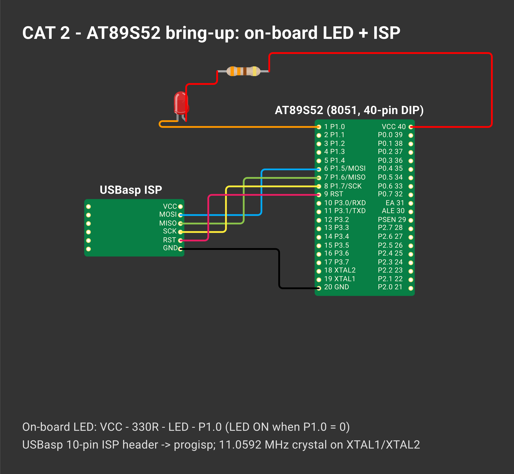

# EXPERIMENT DETAILS

**EXP:** CONTINUOUS ASSESSMENT 2

**DATE:** 20/09/2026

**NAME OF EXP:** 8051 Tool Chain Setup – Development Board – AT89S52

**HARDWARE SETUP / PLATFORM:** AT89S52 development kit (8051 core, 11.0592 MHz crystal) — Keil µVision 5 (C51), progisp + USBasp ISP programmer

---

## TASK 1 : Hardware Board Bring-Up

### 1. Circuit Diagram

| Signal | Pin | Notes |
|---|---|---|
| User LED | P1.2 | **active-LOW** (0 = ON) |
| ISP | P1.5 MOSI, P1.6 MISO, P1.7 SCK, RST | USBasp 10-pin header |
| Supply | VCC pin 40, GND pin 20 | 5 V |

*Drawn on [Wokwi](https://wokwi.com). To open and edit it: start a new project on wokwi.com, paste [`wokwi/diagram.json`](wokwi/diagram.json) into its diagram.json tab, and add the `wokwi/*.chip.json` files (if any) with **New file**.*

### 2. Core Logic / Pseudocode / Code Base

**Working Principle:**

The board parts are checked on the schematic, the 5 V supply is verified, the LED is connected to **P1.2** (active-low), and the PC connects to the AT89S52 through the USBasp ISP programmer.

| Parameter | Entry |
|---|---|
| MCU | AT89S52 |
| CPU core | 8051 (MCS-51), 8-bit, 12 clocks / machine cycle |
| Operating voltage | 5 V (4.0 – 5.5 V) |
| Debug interface | ISP over SPI (USBasp + progisp) |
| LED GPIO port / pin | Port 1 / P1.2 |
| LED active state | LOW (0 = ON, 1 = OFF) |

**Pseudocode:**

1. Identify MCU, programmer, 5 V power pins, and user LED on the board.
2. Check 5 V between VCC (pin 40) and GND (pin 20).
3. Trace the LED to P1.2 (active-low).
4. Build the C code in Keil µVision to get the `.hex` file and flash it using progisp.

**Code Base:**

- Keil µVision project files (`.uvproj`, `STARTUP.A51`)
- Compiled firmware `.hex` file generated in the `Objects/` folder

### 3. Inference

The hardware board is powered, connected to the PC via USBasp, and the Keil-to-progisp toolchain is verified and ready for running bare-metal C programs.

---

## TASK 2 : Bare-Metal LED Blink

### 1. Circuit Diagram

| Signal | Pin | Notes |
|---|---|---|
| User LED | P1.2 | **active-LOW** (0 = ON) |
| ISP | P1.5 MOSI, P1.6 MISO, P1.7 SCK, RST | USBasp 10-pin header |
| Supply | VCC pin 40, GND pin 20 | 5 V |

### 2. Core Logic / Pseudocode / Code Base

**Working Principle:**

The header `<reg51.h>` defines the 8051 Special Function Registers (SFRs). `sbit ledpin = P1^2;` maps the variable `ledpin` directly to bit 2 of Port 1. Inside an infinite `while(1)` loop, `ledpin` is cleared (`0`) to turn the LED ON and set (`1`) to turn it OFF, with a simple `for`-loop `delay()` function called between state changes.

**Pseudocode:**

1. Include `<reg51.h>`.
2. Map `ledpin` to `P1^2` using `sbit`.
3. Define `delay()` using a `for` loop.
4. In `main()`, run an infinite `while(1)` loop:
   - Set `ledpin = 0` (LED ON) and call `delay()`.
   - Set `ledpin = 1` (LED OFF) and call `delay()`.

**Code Base:**
#include <reg51.h>

sbit ledpin = P1^2;

void delay()
{
    int i;

    for(i = 0; i < 1; i++)
    {
    }
}

void main()
{
    while(1)
    {
        ledpin = 0;
        delay();

        ledpin = 1;
        delay();
    }
}