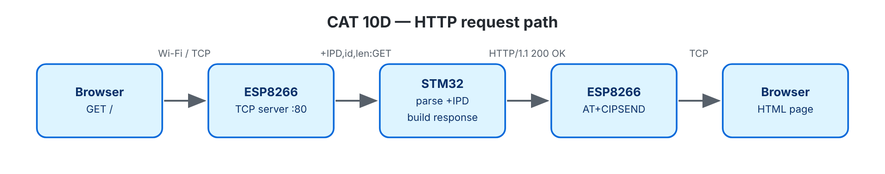

# EXPERIMENT DETAILS

**EXP:** CONTINUOUS ASSESSMENT 10

**DATE:** 05/10/2026 (Tasks 10C/10D: 12/10/2026)

**NAME OF EXP:** STM32–Wemos Wi-Fi Modem Interface Using AT Commands + HTTP Server

**HARDWARE SETUP / PLATFORM:** Blue Pill STM32F103C8T6 (Cortex-M3, 72 MHz) + Wemos D1 mini (ESP8266 AT firmware) + USB-to-TTL — STM32CubeMX + Keil MDK-ARM (STM32CubeIDE project also included), STM32 HAL, PuTTY

---

## TASK 10C / 10D: Configure ESP8266 as a TCP Server, HTTP Response

### 1. Circuit Diagram

| STM32 | Connected to | Purpose |
|---|---|---|
| PA9 USART1_TX | Wemos RX | Sends AT commands |
| PA10 USART1_RX | Wemos TX | Receives responses |
| PA2 USART2_TX / PA3 USART2_RX | USB-to-TTL RX / TX | Connects to PC terminal |
| GND | All GNDs | Common ground |

Both UARTs use **115200-8-N-1**. Wi-Fi passwords go in `Core/Inc/wifi_secrets.h` (ignored by Git; check `wifi_config.h` for the layout).




### 2. Core Logic / Pseudocode / Code Base

**Working Principle:**

By sending configuration commands like `AT+CIPMUX=1` (allow multiple connections) and `AT+CIPSERVER=1,80` (start a server on port 80), the ESP8266 is turned into a working web server.

When you open the web page from any browser on the same network, the request comes into the STM32 starting with `+IPD`. Background interrupts save incoming bytes into a buffer so nothing is missed. The program checks what the browser requested:

- If you visit URLs like `/led/on` or `/led/off`, it toggles the onboard LED (PC13).
- It then builds a standard HTTP response page:

```http
HTTP/1.1 200 OK
Content-Type: text/html
Content-Length: <strlen(body)>
Connection: close

<html><body><h1>STM32 IoT Node</h1>...</body></html>
```

Finally, it sends the page data back using `AT+CIPSEND` and closes the connection cleanly with `AT+CIPCLOSE`.

**Pseudocode:**

1. Initialize the system, connect to Wi-Fi, start the web server, and print out the local web address.
2. Main loop: continuously monitor and process incoming data lines from the ESP8266.
3. For each active client connection: parse the browser request, build the appropriate web page (or a 404 error page if the page doesn't exist), and transmit it.
4. If Wi-Fi ever drops: wait for automatic reconnection and restart the server.

**Code Base:**

- Project files: `CAT10D_HTTP_Server_Static_Page.ioc` (CubeMX configuration), `MDK-ARM/CAT10D_HTTP_Server_Static_Page.uvprojx` (Keil MDK), `.project` / `.cproject` (STM32CubeIDE); application code in `Core/Src/main.c`.
- `esp_at.c/.h` — handles interrupt ring buffers, timeouts, and sending functions.
- USART1 global interrupt enabled (`stm32f1xx_it.c`, `stm32f1xx_hal_msp.c`, `.ioc`).
- `handle_request()`, `http_send()` — parses browser paths and sends back the HTML text.

**Expected Output:**

```
Server running: http://192.168.x.x/
[HTTP] link 0  GET /
[HTTP] link 1  GET /favicon.ico
```

### 3. Inference

The STM32 can successfully act as a web server by receiving browser requests through the ESP8266, dynamically building valid HTML web pages, and serving them over Wi-Fi to let users control hardware directly from a web browser.
