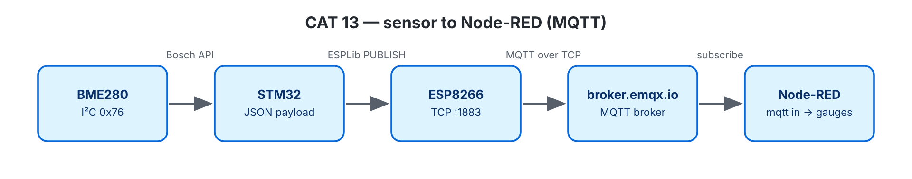

# EXPERIMENT DETAILS

**EXP:** CONTINUOUS ASSESSMENT 13

**DATE:** 27/10/2026

**NAME OF EXP:** BME280 Sensor Interfacing Using I²C and MQTT Using Custom-Built ESP8266 API

**HARDWARE SETUP / PLATFORM:** NUCLEO-F401RE (STM32F401RET6, Cortex-M4F, 84 MHz) + BME280 + Wemos D1 mini — STM32CubeMX + Keil MDK-ARM (STM32CubeIDE project also included), STM32 HAL, ESPLib API (reworked implementation), Node-RED, broker.emqx.io

---

## STEP 1–3: Interface Wrappers (Publish Test)

### 1. Circuit Diagram

Same wiring as CAT 12; CAT13B also uses the onboard LED LD2 (PA5). Connects to MQTT broker **broker.emqx.io:1883**.




### 2. Core Logic / Pseudocode / Code Base

**Working Principle:**

The custom `ESPLib` library connects to Wi-Fi, opens a TCP link to the MQTT broker, and sends a `CONNECT` packet (with a 120-second keep-alive timer and clean session). It waits for the broker to reply with `CONNACK` before moving forward.

If anything fails or the connection drops, it automatically retries every 5 seconds and reconnects. Once connected, the STM32 publishes the message `hello #n from STM32 Nucleo` to the topic `vishrudh/stm32/test` every second.

**Pseudocode:**

1. `mqtt_start()`: Initialize ESP8266 → Connect to Wi-Fi → Open TCP port → Connect to MQTT broker.
2. Main loop: Format the test message, publish it using `MQTT_publishTopic(..., QoS0)`, print status to debug terminal, and wait 1 second.

**Code Base:**

- Project files: `CAT13A_MQTT_Publish_Test.ioc` (CubeMX configuration), `MDK-ARM/CAT13A_MQTT_Publish_Test.uvprojx` (Keil MDK), `.project` / `.cproject` (STM32CubeIDE); application code in `Core/Src/main.c`.
- Main functions: `mqtt_start()`, `dbg()`.

**Expected Output:**

```text
MQTT connected (CONNACK accepted) as stm32-neha-test
PUB neha/stm32/test : hello #1 from STM32 Nucleo
```

**Supporting Notes:**

| ESPLib Function | What It Sends |
|---|---|
| `ESP8266_Init(StationMode, huart1)` | `AT`, `AT+CWMODE=1` |
| `ESP8266_wifiConnect()` | `AT+CWQAP`, `AT+CWJAP` |
| `ESP8266_portConnect("TCP", broker, "1883")` | `AT+CIPSTART` |
| `MQTT_connectBroker()` | `CONNECT` (0x10), `"MQTT"`, protocol level 4, clean session, keep-alive, client ID |
| `MQTT_publishTopic()` | `PUBLISH` (0x30), topic length, topic name, message payload |
| `MQTT_subscribeTopic()` | `SUBSCRIBE` (0x82) |

**Library Improvements:**

`ESPLib.h` keeps the original lab function names so existing code compiles without changes, while `ESPLib.c` and `mqtt_packet.c` fix major reliability issues under the hood.

| Issue in Original Library | Improved Implementation |
|---|---|
| Receive interrupts were turned off during sends, dropping incoming packets. | Receive interrupt stays active continuously using a 1 KB ring buffer. |
| Packet endings were guessed using a 100 ms pause, causing parsing glitches. | Strips `+IPD,<len>:` headers cleanly and reads exact MQTT packet lengths byte-by-byte. |
| Limited to 1-byte lengths without size checks or proper string termination. | Supports up to 4-byte lengths, checks buffer sizes before copying, and safely terminates strings. |
| Never verified broker acknowledgments (`CONNACK` / `SUBACK`), risking infinite loops. | Waits for valid `CONNACK` and `SUBACK` replies with built-in timeouts, returning `funcOk` or `funcErr`. |

**Additional Safeguards & Testing:**

- **Connection Health:** `PINGREQ` verifies broker responses (`PINGRESP`) and triggers a reconnect if the broker is silent. Buffer overflows or dropped packets are tracked and printed when they occur.
- **QoS 0 Support:** Only Quality of Service (QoS) 0 is supported; higher QoS requests or incoming QoS 1/2 packets are safely rejected or ignored. Wildcard topics are blocked, and `UNSUBSCRIBE` waits for `UNSUBACK`.
- **Error Recovery:** If the receive buffer overflows or a bad `+IPD` packet arrives, the library clears the buffer, resets the parser, and runs a full Wi-Fi/MQTT reconnection.
- **PC Verification:** Verified offline using `make -C tests` (54 parser tests + 56 library tests), simulating packet splits, wrong IDs, silent brokers, and mid-packet buffer overflows.

### 3. Inference

MQTT works cleanly on top of a standard ESP8266 TCP connection; the STM32 simply formats the binary MQTT packets and manages reliable byte-stream parsing.
