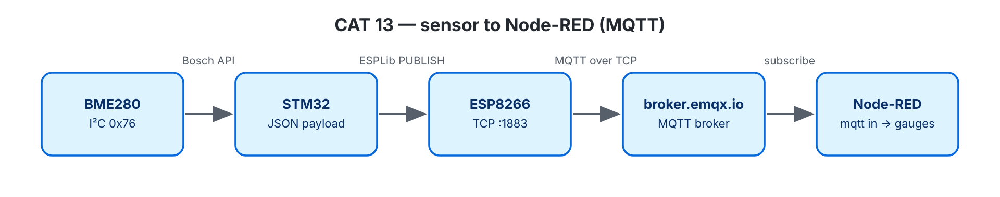

# EXPERIMENT DETAILS

**EXP:** CONTINUOUS ASSESSMENT 13

**DATE:** 27/10/2026

**NAME OF EXP:** BME280 Sensor Interfacing Using I²C and MQTT using Custom Built ESP8266 API

**HARDWARE SETUP / PLATFORM:** NUCLEO-F401RE (STM32F401RET6, Cortex-M4F, 84 MHz) + BME280 + Wemos D1 mini — STM32CubeMX + Keil MDK-ARM (STM32CubeIDE project also included), STM32 HAL, ESPLib API (reworked implementation), Node-RED, broker.emqx.io

---

## SUBSCRIBE EXAMPLE : LED Control

### 1. Circuit Diagram

Same wiring as CAT 12; CAT13B also uses the onboard LED LD2 (PA5). Connects to MQTT broker **broker.emqx.io:1883**.

### 2. Core Logic / Pseudocode / Code Base

**Working Principle:**

After receiving `CONNACK` from the broker, the board subscribes to the topic `neha/stm32/led` and verifies the `SUBACK` confirmation. Inside the loop, `MQTTDataHandler()` returns `1` whenever a complete, valid incoming message (`PUBLISH`) arrives. If the message matches the exact commands `ON`, `OFF`, or `TOGGLE`, it switches the onboard LED (LD2); any other text is ignored. Every 60 seconds, a `PINGREQ` heartbeat is sent to keep the connection active—if the broker stops replying, the board automatically reconnects and resubscribes. `MQTTTimer()` remains in `SysTick_Handler` to match the lab template, though it is no longer required.

**Pseudocode:**

1. Initialize LED (LD2), run `mqtt_start()`, subscribe to the topic with `MQTT_subscribeTopic()`, and start `HAL_UART_Receive_IT()`.
2. Main loop: Check `MQTTDataHandler()`; if a new message arrives, print it and control the LED accordingly.
3. Every 60 seconds: Send `MQTT_pingReq()` to keep the broker connection alive.

**Code Base:**

- Project files: `CAT13B_MQTT_Subscribe_LED_Control.ioc` (CubeMX configuration), `MDK-ARM/CAT13B_MQTT_Subscribe_LED_Control.uvprojx` (Keil MDK), `.project` / `.cproject` (STM32CubeIDE); application code in `Core/Src/main.c`.
- `subscribe_commands()` — sends `SUBSCRIBE`, checks `SUBACK`, and handles reconnecting/resubscribing in the main loop.
- `handle_message()` — reads incoming commands and switches the LED.

**Supporting Notes:**

| ESPLib Function | What It Sends |
|---|---|
| `ESP8266_Init(StationMode, huart1)` | `AT`, `AT+CWMODE=1` |
| `ESP8266_wifiConnect()` | `AT+CWQAP`, `AT+CWJAP` |
| `ESP8266_portConnect("TCP", broker, "1883")` | `AT+CIPSTART` |
| `MQTT_connectBroker()` | `CONNECT` (0x10), `"MQTT"`, protocol level 4, clean session, keep-alive, client ID |
| `MQTT_publishTopic()` | `PUBLISH` (0x30), topic length, topic name, message payload |
| `MQTT_subscribeTopic()` | `SUBSCRIBE` (0x82) |

**Library Improvements:** `ESPLib.h` keeps the original lab function names so existing code compiles without changes, while `ESPLib.c` and `mqtt_packet.c` fix major reliability issues under the hood:

| Issue in Original Library | Improved Implementation |
|---|---|
| Receive interrupts were turned off during sends, dropping incoming packets | Receive interrupt stays active continuously using a 1 KB ring buffer |
| Packet endings were guessed using a 100 ms pause, causing parsing glitches | Strips `+IPD,<len>:` headers cleanly and reads exact MQTT packet lengths byte-by-byte |
| Limited to 1-byte lengths without size checks or proper string termination | Supports up to 4-byte lengths, checks buffer sizes before copying, and safely terminates strings |
| Never verified broker acknowledgments (`CONNACK`/`SUBACK`), risking infinite loops | Waits for valid `CONNACK` and `SUBACK` replies with built-in timeouts, returning `funcOk` or `funcErr` |

**Additional Safeguards & Testing:**
- **Connection Health:** `PINGREQ` verifies broker responses (`PINGRESP`) and triggers a reconnect if silent. Buffer overflows or dropped packets are tracked and printed when they occur.
- **QoS 0 Support:** Only Quality of Service (QoS) 0 is supported; higher QoS requests or incoming QoS 1/2 packets are safely rejected/ignored. Wildcard topics are blocked, and `UNSUBSCRIBE` waits for `UNSUBACK`.
- **Error Recovery:** If the receive buffer overflows or a bad `+IPD` packet arrives, the library clears the buffer, resets the parser, and runs a full Wi-Fi/MQTT reconnection.
- **PC Verification:** Verified offline using `make -C tests` (54 parser tests + 56 library tests) simulating packet splits, wrong IDs, silent brokers, and mid-packet buffer overflows.

### 3. Inference

The same custom library works seamlessly in reverse, allowing Node-RED or any external MQTT client to send commands over the internet to control hardware on the STM32 board.