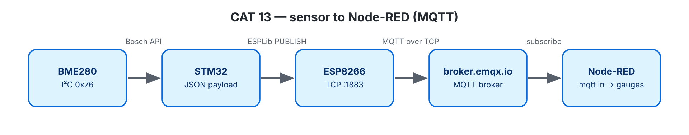

# EXPERIMENT DETAILS

**EXP:** CONTINUOUS ASSESSMENT 13

**DATE:** 27/10/2026

**NAME OF EXP:** BME280 Sensor Interfacing Using I²C and MQTT Using Custom-Built ESP8266 API

**HARDWARE SETUP / PLATFORM:** NUCLEO-F401RE (STM32F401RET6, Cortex-M4F, 84 MHz) + BME280 + Wemos D1 mini — STM32CubeMX + Keil MDK-ARM (STM32CubeIDE project also included), STM32 HAL, ESPLib API (reworked implementation), Node-RED, broker.emqx.io

---

## DEVELOP THE APPLICATION: BME280 JSON over MQTT

### 1. Circuit Diagram

Same wiring as CAT 12; CAT13B also uses the onboard LED LD2 (PA5). Connects to MQTT broker **broker.emqx.io:1883**.




### 2. Core Logic / Pseudocode / Code Base

**Working Principle:**

The Bosch sensor driver is configured the same way as in CAT 12. Every 2 seconds, the board reads temperature, humidity, and pressure, formats them into a JSON text string like:

```json
{
  "status": "success",
  "temperature": 28.45,
  "humidity": 62.30,
  "pressure": 1008.72
}
```

The JSON message is published to the MQTT topic `neha/stm32/bme280` using QoS 0.

**Pseudocode:**

1. Initialize the BME280 sensor (2× oversampling, filter off, normal operating mode).
2. Run `mqtt_start()` to connect to Wi-Fi and the MQTT broker.
3. Main loop: Read sensor values, format them with `build_json()`, publish the message, print status to the terminal, and wait 2 seconds.

**Code Base:**

- Project files: `CAT13C_BME280_MQTT_NodeRED.ioc` (CubeMX configuration), `MDK-ARM/CAT13C_BME280_MQTT_NodeRED.uvprojx` (Keil MDK), `.project` / `.cproject` (STM32CubeIDE); application code in `Core/Src/main.c`.
- Main functions: `build_json()`, `bme_setup()`, `bme_read()`, `fmt_2dp()`.

**Expected Output:**

PUB neha/stm32/bme280 {"status":"success","temperature":28.45,"humidity":62.30,"pressure":1008.72}


### 3. Inference

Live sensor readings reach any subscribed MQTT client over the internet, without the STM32 needing to know who or where the receivers are.

---

## NEXT STEP: Node-RED

### 1. Circuit Diagram

Same wiring as CAT 12; CAT13B also uses the onboard LED LD2 (PA5). Connects to MQTT broker **broker.emqx.io:1883**.


### 2. Core Logic / Pseudocode / Code Base

**Working Principle:**

- `NodeRED_CAT13_MQTT_flow.json`: Uses an **mqtt in** node (configured to parse JSON) connected to a function node that separates temperature, humidity, and pressure into debug outputs and a statistics table. It also includes `ON`, `OFF`, and `TOGGLE` inject buttons connected to an **mqtt out** node to control the LED from CAT13B.
- `NodeRED_CAT13_Dashboard_flow.json`: Displays three live gauges and a historical trend chart on a web dashboard (requires `node-red-dashboard`, accessible at `/ui`).

**Pseudocode:**

1. Import the flow file into Node-RED and click **Deploy**.
2. Watch the debug messages or live dashboard gauges update automatically every 2 seconds.

**Code Base:**

- `NodeRED_CAT13_MQTT_flow.json`
- `NodeRED_CAT13_Dashboard_flow.json`

### 3. Inference

Node-RED subscribes to the MQTT broker topic using the `mqtt in` node, parses the incoming JSON data, and displays all three live BME280 environmental readings visually through gauges and historical trend charts. It also allows remote LED control through MQTT commands.

